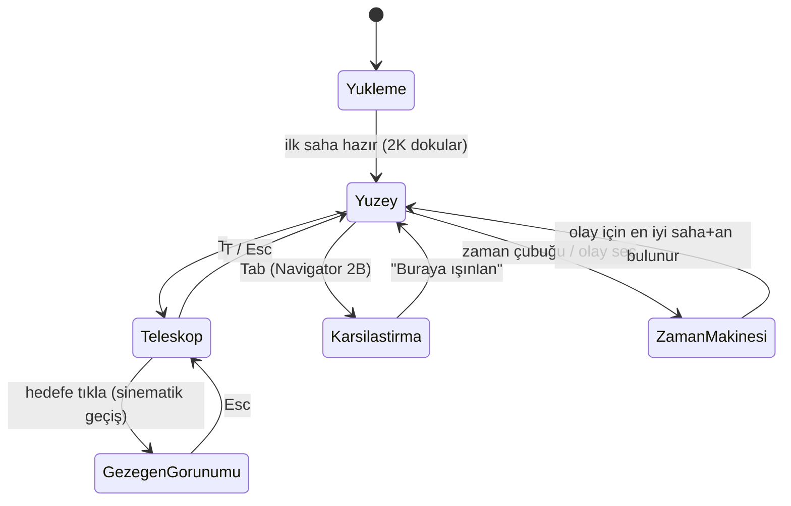
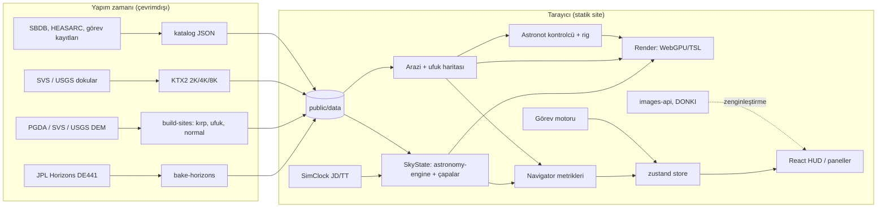

# LUNAR TIMEWALKER — Tasarım Dokümanı

> Çalışma adı (değiştirilebilir). NASA Space Apps Challenge 2026 — Sakarya.
> Durum (14 Kasım 2026): oynanabilir; `npm run typecheck`, `npm test` (JPL Horizons, sahneleme, Patlama Laboratuvarı modeli, çeviri kapsamı) ve `npm run build` temiz. Her ekran 7 dilde 1280×720 ve 1024×640 boyutlarında otomatik DOM denetiminden (ekran dışı / üstü kapalı / üst üste binen düğme, taşan panel, bozuk görsel, ham metin) geçirildi.
> Tarih: 2026-11-14.
> **Yapıldığı hâliyle (plandan sapmalar):** Three.js 0.187 `WebGLRenderer` + GLSL (WebGPU değil); dokular WebP (KTX2 değil); arazi = SVS #4720 `ldem_16` tam çözünürlük + PGDA LOLA 5 m/px `Site04` (Shackleton) ve `Site01` (Bağlantı Sırtı) + CPU/GPU ortak istatistiksel krater alanı, kamera merkezli clipmap ve 4 kademeli Güneş gölge haritası; astronot = NASA Mark III giysi modelinin eklemlere bölünmesi; her bölümde “önce → olay → sonra” sahneleme yönetmeni (`src/game/director.ts`). Aşağıdaki bölümler ilk tasarımı anlatır; güncel davranış için README’ye ve şu eklere bakın:
>
> - **Diller (`src/core/l10n.ts`, `tools/i18n.ts`):** her metin kaynakta `{ tr, en }` olarak durur; Almanca, Fransızca, İspanyolca, İtalyanca ve Rusça, İngilizce metne anahtarlanmış sözlüklerdir (`public/assets/i18n/<dil>.json`, dil seçilince indirilir; eksik metin İngilizce görünür). Değer içeren metinler `tpl\`…\`` şablonlarıdır ve sözlükte `{0}`, `{1}` yer tutucularıyla aranır. `tools/i18n.test.ts` her dilin her metni kapsadığını ve yer tutucuların korunduğunu sınar.
> - **Patlama Laboratuvarı (`src/views/lab/`):** `physics.ts` bir kurulum (`LabSetup`: tür — süpernova, gama ışını patlaması, CME —, yön, uzaklık, CME gücü) için Dünya’nın sonucunu (`computeLabImpact`: parlaklık, ozon, atmosfer/okyanus/kabuk/dağılma eşikleri, itilme; CME’de manyetopoz, kutup ışığı enlemi ve uyduların durumu) ve zamanlanmış adımları hesaplar; `computeLabFates` aynı modeli Ay, Güneş, yedi gezegen ile eklenebilen Plüton, Titan ve Europa’ya kendi yarıçap, kütle ve uzaklıklarıyla uygular (CME’de 70°’lik koni, gama ışını patlamasında iki 12°’lik hüzme: içindekiler vurulur, dışındakiler ıskalanır). `index.ts` logaritmik uzaklık haritasında patlamayı ve cisimlerin tepkisini çizer; çizilen her şey patlamadan beri geçen sürenin fonksiyonudur, bu yüzden gösterim duraklatılıp sarılabilir. `link.ts` senaryoyu adres sorgusuna çevirir ve geri okur; `quiz.ts` sınıf modunun sorularını tutar (yanıt modelin sonucudur); `watch.ts` laboratuvar süpernovasını yüzeyden izlenen bir olaya (`EventDef` + `SupernovaDef`) dönüştürür, motor onu diğer olaylar gibi oynatır. Durum `LabState` içindedir (`fates`, `removed`, `focusId`, `anchorId`, `paused`, `runSec`, `quiz`). Model ve kaynakları README §3’te.
> - **Olayları başka gezegenlerden izleme (`engine.ts`: `pickSeat`, `holdSeatToStars`, `beginEventHere`):** gözlem noktası hedef ≈30° yükseklikte ve Güneş ufkun altında olacak biçimde seçilir; sahneleme boyunca noktanın başucu aynı yıldızlara tutulur (gezegenin her dönüşünde tek kare). `EventDef.seenFrom` olayın yalnızca Ay’dan mı (`moon`), Dünya–Ay’a özgü bir dizilim olarak mı (`earthMoon`) yoksa her yerden mi (`anywhere`) izlenebildiğini belirtir.
> - **NaN koruması (`src/game/guardPass.ts`):** bloom’dan önce NaN/Inf/negatif pikselleri temizleyen geçiş; tek bir bozuk piksel bloom tarafından siyah kareye yayılıyordu. Kaynak gölgelendiriciler de düzeltildi.
> - **Dar pencereler (`src/ui/useFit.ts`):** çubuk taşarsa en az gerekli düğmeler sırayla `⋯` menüsüne alınır ya da gizlenir; kesme noktası yerine ölçüme dayanır, bu yüzden uzun sözcüklü dillerde de çalışır.
> - **Dokunmatik giriş (`src/core/input.ts`, `src/core/pinch.ts`):** yüzeyde birincil parmak bakışı döndürür ve dokunuşu tıklama sayar; yürüme ekrandaki tuşlardan gelir (`Input.setKey`, `GameAPI.pressKey`) ve ilk gerçek tuşa basılınca kaybolur. Küre, galaksi, kalıntı ve laboratuvar görünümlerinde iki parmak tekerlek olayına çevrilir (`attachPinch`), böylece her görünümün kendi yakınlaştırma kodu aynı kalır. Tuşlar fiziksel konumla (`KeyboardEvent.code`) izlenir; yalnızca `+` ve `−` yazılan karakterle izlenir, çünkü Türkçe Q klavyede bu tuşlar başka yerdedir.
> - **Sayfa geçişleri (`engine.ts`: `journey`, `clearPageState`, `landingLoads`):** her sayfa değişimi bir sayaç artırır; geç gelen bir yükleme (iniş, galaksi görüntüsü, arşiv) başladığı sayfa hâlâ açık değilse hiçbir şeye dokunmaz. İnişler sırayla yüklenir (gökyüzü, arazi ve araçlar tek bir yeri tutar); yükleme başarısız olursa ana menüye dönülür ve nedeni yazılır. Sayfa değişiminden sonraki 400 ms’de tıklamalar yutulur (çift tıklamanın ikinci tıklaması yeni sayfada bir şeye basmasın diye).
> - **Pencereler ve klavye (`src/ui/useDialog.ts`, `core/input.ts`: `keyBelongsToControl`):** her pencere `role="dialog"` taşır, odağı alır, `Tab`’ı içinde tutar ve kapanınca odağı açan düğmeye verir. Bir pencere ya da kart sahneyi örterken yüzey tuşları işlenmez. Fareyle ya da parmakla kullanılan düğme, sürgü ve liste odağı bırakır; yazı alanları ve klavyeyle gelinen denetimler odağı tutar.
> - **Hata yolları:** WebGL başlatılamazsa açılış ekranı nedenini yazar (`main.tsx`); bağlam kaybolursa çizim ve saat bekler, geri gelince ortam haritası yeniden kurulur. Bozuk kayıtlı ayarlar varsayılana döner (`sanitiseSettings`); başarısız sözlük, model ve doku yüklemeleri önbelleğe alınmaz, yeniden denenebilir. DONKI kayıtları doğrulanır (`parseDonki`): eksik ölçümü olan bir CME çizilmez.

---

## 0. Önce okunmalı: yarışma kuralları tasarımı nasıl bağlıyor

Kaynak: resmi Participant FAQ (https://www.spaceappschallenge.org/resources/participant-faqs/, 5 Kasım 2026 sürümü).

| Kural (resmi metin) | Tasarıma etkisi |
| --- | --- |
| "Teams **are not allowed** to begin working on the challenges prior to the hackathon." Etkinlik: 14–15 Kasım 2026. | Uygulama kodu 14 Kasım 09:00 (TRT) öncesinde yazılmamalı. Bu doküman bile sıkı yorumda "challenge çalışması" sayılabilir; nasıl kullanılacağı takım kararı (bkz. §13). Yapım planı (§11) 48 saate sığacak dilimlerle kuruldu. |
| "teams are only permitted to work on **one** challenge." | "Üç başlığı %100 karşılama" hedefi tek gönderimde mümkün değil. Bir ana başlık seçilir; diğer ikisinin fikirleri özellik olarak kalır ama onlar için puan beklenmez. Öneri: §1. |
| "Each team's project submission must include a description of how SI tools were used" (FAQ, yapay zekâ için "SI" terimini kullanıyor). | Claude Code kullanımı proje sayfasında açıkça beyan edilecek. README'ye hazır beyan metni konacak. |
| Proje Gönderim ve Jüri rehberleri 13 Kasım'da yayımlanıyor. | Jüri ölçütleri (2025: Impact, Creativity, Validity, Relevance, Presentation) ve NASA logosu/marka yasağı 2025 kurallarından biliniyor; 2026 için `[DOĞRULANACAK — 13 Kasım]`. Sertifikada NASA amblemi kullanılmayacak. |
| Gönderim: 14 Kasım 09:00 – 15 Kasım 23:59 yerel saat. | Kesin son: 15 Kasım Pazar 23:59 TRT. Plan 46. saatte gönderir, 2 saat tampon. |

---

## 1. Ana başlık seçimi (karar bekliyor)

Üç başlığın resmi metni okundu. Vizyonla eşleşme:

| Başlık | Zorunlu çekirdek | Vizyonda karşılığı | Uyum |
| --- | --- | --- | --- |
| **Lunar Landing Site Navigator** | İniş yeri + tarih karşılaştırma; Güneş ve Dünya'nın ufka göre konumu; güç ve DTE pencereleri; gün batımına/Dünya batımına kalan süre | Telemetri paneli, saha seçimi (Shackleton / Apollo 11 / Tycho), zaman makinesi, Görev 3 | **Yüksek** — metin "educational game" biçimini açıkça kabul ediyor |
| Abandoned but not Forgotten | Ay/Mars'ta bırakılan donanımın hikâyesi, okul çağı kitlesi | Apollo 11 sahası, Mars görevleri, zaman çizelgesi | Orta — hikâye anlatımı ana eksen olmalı |
| Build a Junior Astronaut Mission Trainer | 7–12 yaş; üs yönetimi; "bedelsiz seçim yok" kaynak takası | Yalnızca Görev 3'te kısmen | Düşük — metin "görsel cila mekanik doğruluğun yerini tutmasın" diye uyarıyor |

**Öneri: "Lunar Landing Site Navigator" ana başlık.** Gerekçe: (a) vizyondaki telemetri paneli başlığın tam karşılığı, (b) hesap motorumuzun JPL Horizons ile 0.003° içinde örtüştüğü ölçüldü (§4.2) — "Validity" ölçütü için somut kanıt, (c) başlık 3B görselleştirme ve oyun biçimini teşvik ediyor.

Sonuç: Navigator **omurga**dır; süpernova, Mars teleskobu ve tarihî gökyüzü olayları onun üzerine binen "keşif modu"dur. Süpernova/Mars içerikleri hiçbir başlığın çekirdeği değil; "Presentation/Creativity" puanı getirir, "Relevance" puanı getirmez. Zaman sıkışırsa kesilecek olan onlardır, Navigator değil.

Sunum cümlesi: *"İçinde yürüyebildiğiniz bir iniş yeri seçim aracı: aynı sayılar hem karşılaştırma tablosunda hem ayağınızın altındaki gölgede."*

---

## 2. Ürün tanımı

Tarayıcıda, kurulum ve hesap gerektirmeden açılan tek sayfa. Oyuncu bir **astronottur** (§6): Ay yüzeyinde LOLA topoğrafyası üzerinde yürür, 1.62 m/s² altında zıplar, ellerini görür. Üç katman:

1. **Navigator (omurga):** Saha × tarih için Güneş/Dünya ufuk geometrisi, güç, DTE, sıcaklık, radyasyon. 2B karşılaştırma görünümü + 3B yüzeyde aynı verinin yaşanması.
2. **Zaman Vizörü (keşif):** M.Ö. 3000 – M.S. 2035. Ay göğünde gerçek koordinatlı tarihî olaylar. Teleskopla gezegene geçiş.
3. **Görevler:** Yukarıdaki iki katmanı öğreten, veriyle puanlanan görev zinciri; TR/EN; 4K ekran görüntüsü ve sertifika.

Oyun durumları:

---

## 3. Teknoloji kararları

### 3.1 Sürümler (npm registry'den 2026-11-12'de okundu)

`three 0.187.0` · `vite 8.3.8` · `typescript 7.0.2` · `react 19.3.1` · `zustand 5.1.0` · `astronomy-engine 2.1.19` · `vitest 5.1.0` · `@playwright/test 1.65.0`. Karşılaştırılanlar: `@babylonjs/core 9.36.0`, `playcanvas 2.24.1`, `cesium 1.147.0`, `postprocessing 6.39.6`, `@react-three/fiber 9.8.2`.

Geliştirme makinesi (ölçüldü): Apple M5, Chrome 157, Node 26.10, Python 3.14.8, `uv` var; GDAL ve KTX araçları kurulu değil.

### 3.2 Render motoru

| Aday | Artı | Eksi | Karar |
| --- | --- | --- | --- |
| **Three.js `WebGPURenderer` + TSL** | Tek shader kodu → WebGPU'da WGSL, yedekte WebGL2/GLSL; yerleşik düğüm tabanlı post (bloom vb.); compute shader; en geniş örnek havuzu | TSL API'si sürümler arasında değişiyor; eski GLSL `ShaderMaterial` ve `EffectComposer` çalışmıyor; KTX2'de `await renderer.init()` sonrası `detectSupport` sırası kritik | **Seçildi** |
| Three.js `WebGLRenderer` + GLSL + `postprocessing` | En olgun, en az sürpriz | Yeni geliştirme WebGPU tarafında; compute yok | **Yedek** (aşağıdaki kapı) |
| Babylon.js 9 | Kutudan çıkan fizik, GUI, Inspector, WGSL-yerli çekirdek | Daha büyük paket; özel arazi/ufuk gölgesi shader'ı için avantajı yok; ekosistem daha küçük | Elendi |
| CesiumJS (+Three hibrit) | Küresel 3D Tiles akışı | Birinci şahıs yürüyüş, özel ışıklandırma ve post üzerinde kontrol zayıf; üçüncü taraf barındırma bağımlılığı | Elendi |
| PlayCanvas | Güçlü motor | Editör merkezli akış; bu proje kod-öncelikli | Elendi |
| React Three Fiber | Bildirimsel sahne | Oyun döngüsü ağırlıklı projede WebGPU + reconciler ek risk; fayda yok | Kullanılmıyor (React yalnız HUD için) |

**Dürüst not:** Bu sahnede darboğaz piksel doldurma (4K = 8.3 M piksel), çizim çağrısı sayısı değil. WebGPU ile WebGL2 arasında GPU-sınırlı kare süresi farkı küçük olur `[ÇIKARIM]`. WebGPU'yu seçme nedeni ham hız değil; tek shader kod tabanı, compute ve Three.js geliştirmesinin yönü.

**Render kapısı (yapımın ilk 3 saati):** arazi + gökyüzü + bloom dikey dilimi şu dördünü sağlamalı: (1) WebGPU'da 2560×1440'ta ≥ 60 fps (M5), (2) `forceWebGL: true` ile aynı görüntü, (3) 8K KTX2 doku iki arka uçta da yükleniyor, (4) konsol hatası sıfır. Biri sağlanmazsa `WebGLRenderer` + GLSL'e geçilir; render'a özgü kod yalnızca `src/render/` ve `*Material.ts` dosyalarında tutulduğu için geçiş yereldir.

### 3.3 Astronomi motoru — hibrit, çalışma zamanında backend yok

| Katman | Araç | Neden |
| --- | --- | --- |
| Tarayıcı, gerçek zamanlı | `astronomy-engine` (MIT, 135 KB min) | Tam gök durumu **0.023 ms** (ölçüldü) → her karede hesaplanır; ağ gerektirmez |
| Yapım zamanı, "çapa" tabloları | JPL Horizons API, DE441 | Tarihî olay pencereleri için kesin konumlar + doğrulama satırları JSON olarak gömülür |
| Yapım zamanı, varlık hattı | Python (`uv` + `rasterio` + `numpy`) | COG DEM kırpma, ufuk haritası, normal haritası |

Python/FastAPI çalışma zamanı backend'i **reddedildi**: jüri bağlantıyı açtığında ayakta olması gereken bir sunucu, 48 saatlik projede saf risk. Site tamamen statik barındırılır.

Horizons'ı tarayıcıdan canlı çağırmak **mümkün değil** (ölçüldü): yanıtta `Access-Control-Allow-Origin` yok ve eşzamanlı gönderilen 7 istekten 5'i `503` döndü. Bu yüzden Horizons verisi yapım zamanında, sıralı ve beklemeli çekilir.

### 3.4 Diğer kararlar

| Konu | Karar |
| --- | --- |
| Dil | TypeScript (strict). Varlık hattı: Python. |
| UI | React 19 yalnızca DOM HUD/paneller; motor ↔ UI köprüsü `zustand` (HUD 5 Hz'e kısılır) |
| Fizik | Özel kinematik kontrolcü + yükseklik alanı örneklemesi. Fizik kütüphanesi yok (kapsül–yükseklik alanı çarpışması için gereksiz). |
| i18n | Kaynakta `{ tr, en }` metinler + İngilizce metne anahtarlanmış, tembel yüklenen sözlükler (de, fr, es, it, ru); `tools/i18n.ts` (scan / extract / merge). Kütüphane yok. |
| Ses | Doğrudan Web Audio API; sesler prosedürel sentez (lisans riski yok) |
| Grafikler | Elle yazılmış SVG/Canvas (bağımlılık yok) |
| Test | `vitest` (zaman, efemeris, ufuk) + Chrome DevTools/Playwright duman testi |
| Barındırma | GitHub Pages (dosya başına 100 MB sınırı 8K KTX2 için yeterli). Cloudflare Pages'in dosya sınırı düşük `[DOĞRULANACAK]`. |

---

## 4. Astronomi ve zaman çekirdeği

### 4.1 Zaman

- İç temsil: **Julian Günü, TT**. UT, ΔT modeliyle türetilir (astronomy-engine: Espenak–Meeus).
- JS `Date` kullanılmaz: proleptik Gregoryen'dir, oysa tarihî kayıtlar Jülyen takvimindedir. "4 Temmuz 1054" bir **Jülyen** tarihidir. Gösterim: 1582-10-15 öncesi Jülyen, sonrası Gregoryen (Horizons ile aynı kural).
- Yıl 0 sorunu: "M.Ö. 7" = astronomik yıl −6. UI "M.Ö./BC" gösterir, çekirdek astronomik yıl kullanır.
- ΔT (ölçüldü): 2026'da 75.4 s (model; gerçek ≈ 69 s, etkisi ihmal edilebilir), 1054'te 1292 s, M.Ö. 3000'de **20.6 saat**. Sonuç: M.Ö. tarihlerde Dünya'nın hangi yüzünün Ay'a baktığı bilinemez; Dünya dokusu o çağlarda "dönüş fazı belirsiz" etiketiyle gösterilir. Gezegen konumları bundan etkilenmez.

### 4.2 Ay yüzeyinden bakış (Navigator'ın kalbi) — yöntem ve ölçülen doğruluk

Yöntem: `RotationAxis(Moon)` → IAU kutup (α₀, δ₀) ve başlangıç meridyeni W → gövde-sabit ↔ ICRF dönüşümü `Rz(α₀+90°)·Rx(90°−δ₀)·Rz(W)`. Saha (enlem, doğu boylam) için yerel doğu/kuzey/yukarı tabanı; hedef vektörü = hedef(yer-merkezli) − (Ay + saha). Azimut kuzeyden doğuya, yükseklik `asin(d·up)`. Atmosfer yok → kırılma düzeltmesi yok.

Bu yöntem tek kullanımlık bir betikle JPL Horizons'a (`CENTER='coord@301'`) karşı sınandı:

| Sınama | astronomy-engine | JPL Horizons (DE441) | Fark |
| --- | --- | --- | --- |
| Güneş, Shackleton yakını (−89.45°, 222.8°E), 2026-08-12 17:00 UT | az 321.5794°, yük 0.1825° | az 321.5766°, yük 0.1813° | 0.003° / 0.001° |
| Dünya, Apollo 11 (0.6741°N, 23.4730°E), 1054-07-04 00:00 UT | az 268.921°, yük 59.344° | az 268.927°, yük 59.297° | 0.006° / 0.048° |

Güney kutbunda Güneş yüksekliğinin 0.18° olması, başlığın "aşırı aydınlatma koşulları" vurgusunun doğrudan göstergesi.

Yer-merkezli astrometrik konum hatası (astronomy-engine − Horizons DE441, TT epokları):

| Epok | Gezegenler (Merkür–Satürn) | Ay |
| --- | --- | --- |
| 2000-05-05 | ≤ 5.5″ | 20″ |
| 1054-07-04 | ≤ 29″ | 162″ (0.045°) |
| M.Ö. 7 | 22″ – 6′ | ≈ 12–14′ |
| M.Ö. 44 | 23″ – 3.2′ | ≈ 14′ |
| M.Ö. 3000 | 3.4′ – 18.5′ | 78′ (1.3°) |

M.Ö. 7 Jüpiter–Satürn ayrıklığı (29 May / 30 Eyl / 5 Ara): motor 1.023° / 1.026° / 1.094°, Horizons 0.985° / 0.976° / 1.054°. Üçlü kavuşumun üç minimumu motor tarafından bulundu.

**Tasarım sonucu:** 1600–2100 arası motor tek başına yeterli. Daha eski kurgulu olaylarda Horizons çapa tablosu kullanılır. Arayüzde her an bir **doğruluk rozeti** görünür ("JPL DE441 çapalı" / "model, ±0.05°" / "model, ±0.3°"); rozet bu tablodan beslenir.

### 4.3 Horizons çapa tabloları (yapım zamanı) — öğrenilen tuzaklar

- M.Ö. tarih dizgesi `'BC 0007-05-27'` reddedildi → istekler **JD listesi** (`TLIST`, `TLIST_TYPE=JD`, `TIME_TYPE=TT`) ile yapılır.
- `499` (Mars gövde merkezi) 1600 öncesi efemeris vermiyor ("No ephemeris for target Mars prior to A.D. 1600") → tarihî epoklarda **barisantrlar** (`4`, `5`, `6`) kullanılır.
- Her olay için: Güneş, Dünya, Merkür–Satürn'ün Ay-merkezli ICRF vektörleri, ±15 gün, 1 saat adım, kübik Hermite ara değerleme. Ek olarak her saha için birkaç az/yük doğrulama satırı → birim testleri ve uygulama içi "doğruluk" paneli.
- İstekler sıralı, 1.5 s aralıklı, 503'te geri çekilmeli.

### 4.4 Diğer hesaplar

- **Kuyruklu yıldızlar:** Kepler ilerletme. Öğeler yapım zamanında gömülür. C/-43 K1 (M.Ö. 44) Horizons/SBDB'de var: q = 0.22 AU, e = 1, i = 110° (Ramsey & Licht çözümü, parabolik — "yörünge belirsiz" etiketi). Halley için Horizons'ta −239…1968 arası 30 geçiş kaydı var.
- **Tutulma gölgesi:** Ay'ın umbra/penumbra konisinin Dünya küresiyle kesişimi efemeristen hesaplanır; Dünya shader'ına coğrafi konumlu koyulaşma olarak girer. Elle boyanmaz.
- **Işık süresi:** Dünya (≈ 1.28 s), Mars ve diğer hedefler için tek yön gecikme; "X dakika önceki hâlini görüyorsun" okuması.
- **Yükseliş/batış aramaları:** Arazi ufku dâhil, Güneş ve Dünya için (ikiye bölme + adım). Bir Ay günü taraması (29.5 gün × 10 dk ≈ 4250 durum ≈ 100 ms) Web Worker'da.

---

## 5. Arazi ve render tasarımı

### 5.1 Saha paketleri

| Saha | Yakın DEM | Uzak DEM | Kaynak |
| --- | --- | --- | --- |
| Shackleton kenarı / Bağlantı sırtı | 5 m/px, ≈ 10×10 km | 80 m/px, ≈ 160×160 km | PGDA LOLA `Site04`, `Site01` (41 MB) + `LDEM_80S_80MPP_ADJ.TIF` (189 MB, COG) |
| Apollo 11 (Sükûnet Denizi) | LROC NAC DTM `NAC_DTM_APOLLO11` `[DOĞRULANACAK: indirme yolu]` | SVS `ldem_64.tif` kırpması | LROC / SVS #4720 |
| Tycho | NAC DTM `NAC_DTM_TYCHOPK` `[DOĞRULANACAK]` | SVS `ldem_64.tif` kırpması | LROC / SVS #4720 |
| Özel koordinat | — | SVS `ldem_16.tif` (5760×2880, 66 MB) | Navigator 2B görünümü için ufuk hesabı |

PGDA dosyaları `Accept-Ranges: bytes` destekliyor (206 yanıtı alındı) → GB'lık dosyalar indirilmeden pencere okunur.

Her saha paketi: yükseklik (16 bit, RG8'e paketli; 6.2 km aralıkta ≈ 9.5 cm çözünürlük — half-float burada 2–4 m basamak yapar, kullanılmaz), normal haritası (KTX2 UASTC), albedo kırpması, **ufuk haritası**, coğrafi referans JSON'u.

### 5.2 Ufuk haritası — bir veri, üç kullanım

Her doku hücresi için K azimutta (64) arazi ufkunun yükseklik açısı, Ay eğriliği düzeltmesiyle (`d²/2R`), yapım zamanında hesaplanır (512² × 64, 16 bit ≈ 32 MB).

1. **Gölge:** Fragment shader'da Güneş azimutunda ufuk açısı okunur; Güneş diski (0.53°) ile kısmi örtüşmeden yarı gölge. Kutupta 0–2° Güneş yüksekliğinde onlarca km uzaktan düşen gölgeler, gölge haritası kaskadları olmadan ve fiziksel doğrulukla elde edilir.
2. **Telemetri:** "Güneş arazi ufkunun X° üstünde, diskin %Y'si görünür", gün batımına kalan süre.
3. **DTE:** Dünya'nın arazi ufkuna göre görünürlüğü.

Yakın nesneler (astronot, kayalar, donanım) için oyuncu çevresinde tek bir 2048² gölge haritası.

### 5.3 Geometri ve yüzey

- İç içe **geometri clipmap** halkaları (oyuncu merkezli, 6 seviye); vertex shader yükseklik dokusunu örnekler; uzak halkalarda eğrilik düşümü uygulanır (göz hizasından Ay ufku ≈ 2.4 km).
- DEM çözünürlüğünün altında **prosedürel ayrıntı** (fraktal gürültü + krater boyut-sıklık dağılımına uyan küçük kraterler). Arayüzde açık etiket: "5 m altı ayrıntı istatistiksel modeldir, ölçüm değildir."
- Regolit BRDF: Lommel–Seeliger + karşı-ışıma parlaması. Sonuç: oyuncunun kendi gölgesinin baş çevresinde hale (Apollo'da gözlenen heiligenschein).
- HDR hattı fiziksel aydınlanma oranlarıyla çalışır; **otomatik pozlama** (göz uyumu) sayesinde Ay gecesinde Dünya ışığı ve süpernova ışığı araziyi görünür kılar.

### 5.4 Gökyüzü

- Yıldız zemini: SVS #4851 `starmap_2020_8k.exr` → 8192×4096 WebP (sRGB, tonlanmış). ICRF'de sabit; Ay yönelimi ve saha konumuyla döndürülür. Mip düzeyi görüş alanından açıkça hesaplanır (`textureLod`), böylece RA 0h dikişi oluşmaz. Parlak yıldızlar ayrı nokta katmanı (HEASARC `bsc5p`).
- Atmosfer yok: yıldızlar göz kırpmaz, gündüz gökyüzü siyahtır. Bu bir özellik olarak öğretilir.
- Gezegenler gerçek açısal boyutta (çıplak gözle nokta); parlaklık kadir modelinden.
- Dünya: o tarihin görüntüsü (`src/content/earthImagery.ts`): bölüm tarihlerinde NASA GIBS gerçek bulutlu mozaik, diğer günlerde aynı ayın Blue Marble NG birleşimi; Black Marble 2016 gece ışıkları (1880–1990 arası doğrusal artış), okyanus parıltısı, faz, yıldız zamanından dönüş, kenar saçılımı, tutulma gölgesi.
- Güneş: HDR disk + bloom + ekran uzayında lens parlaması (`src/sky/flare.ts`; teleskopta ve eldiven örtünce söner). Korona yalnız disk örtüldüğünde görünür.
- Birinci şahısta kask vizörü son işlem geçişi (`src/game/visorPass.ts`): kenar vinyeti, hafif radyal renk sapması, çok hafif gren. Fotoğraflarda kapalıdır.

### 5.5 Doku ve bellek stratejisi

- Biçim: WebP (sRGB). Tarayıcıda açılınca sıkıştırılmamış olur: 8192×4096 ≈ 128 MB + mip ≈ 170 MB GPU belleği. KTX2 denenmedi.
- **Katmanlar:** her doku 2K / 4K / 8K ayrı dosya; `texUrl` GPU'nun `MAX_TEXTURE_SIZE` değerini aşan katmanı atlar. Yüksek ve Ultra kalite 8K kullanır.
- **8K yalnız ≥ 8192 px kaynaktan:** `save_tiers` daha küçük kaynaktan 8K üretmeyi reddeder. Ay kabartma normal haritası bu yüzden 4K (LOLA 16 px/derece).
- Küre görünümlerinde dokular önbellekte tutulur, en fazla 5 tanesi (LRU); gökyüzündeki Mars küçük göründüğü için 2K kullanır.

### 5.6 Ekran görüntüsü

4K (3840×2160) ve 8K (7680×4320) fotoğraflar 1920×1080'lik karolar halinde çizilir: her karo 96 px kenar payıyla `setViewOffset` ile işlenir, kenar payı kırpılarak 2B tuvalde birleştirilir (bloom dikiş yapmaz). Gökyüzü ve yakın sahne kameraları aynı ofseti kopyalar; lens parlaması karonun NDC dikdörtgenine göre çizilir. Böylece GPU belleği normal oyundakinden fazla gerekmez. HUD fotoğrafa girmez.

---

## 6. Oyuncu karakteri: astronot

NASA 3D Resources incelendi (GitHub `nasa/NASA-3D-Resources`, 257 GLB): `Astronaut.glb` (6.4k üçgen), `Astronaut Glove.glb` (842 üçgen), `Mark III Spacesuit.glb` (69k üçgen, metrik ölçek). **Hiçbiri rigli değil** (`skins = 0`, animasyon yok).

**Karar (yapıldığı hâliyle): rijit parçalı giysi, NASA Mark III modelinden.** Uzay giysisi zaten yataklı sert bölümlerden oluşur; Mark III GLB'si yükleme anında üçgen düzeyinde gövde, kask, üst kol, ön kol + eldiven, uyluk, baldır + bot parçalarına ayrılır; omuz, dirsek, kalça ve diz eksenleri ağın kendisinden ölçülür (`src/player/suit.ts`). Birinci şahısta kask ve yaka gizlenir; üçüncü şahıs gövdesi birinci şahısta yalnızca gölge düşürür. NASA `Astronaut Glove.glb` (842 üçgen) yetersiz bulunduğu için kullanılmaz.

| Öğe | Tasarım |
| --- | --- |
| Birinci şahıs gövde | Kollar, eldivenler, kask kenarı, göğüs ünitesi görünür. Aşağı bakınca gövde, botlar ve **kendi gölgen** görünür. |
| Zıplama | Kalkışta kollar denge için yukarı kalkar ve **görüş alanına girer**; tepe noktasında süzülür; inişte dizler bükülür, kollar aşağı salınır, toz kalkar. |
| Animasyon | Klip yok. Yay-sönüm sürücülü hedefler + iki kemikli analitik IK. Durumlar: bekleme, yürüme (düşük yerçekimi salınımı), koşu (Apollo "kanguru sekmesi"), zıplama, tarama, yerleştirme. |
| Hareket | Yerçekimi 1.62 m/s². Giysili zıplama hızı ≈ 2 m/s → ≈ 1.3 m yükseklik, ≈ 2.5 s havada kalış. Koşu (Shift) 0.7 m/s'lik alçak sıçramalar zinciridir (≈ 0.15 m, ≈ 0.85 s). Eğim: yokuş yukarı hız 1/(1+2.2·tan), tan > 0.7 (≈ 35°) tırmanılamaz; yokuş aşağı en çok %15 hızlanma. Çarpışma: 0.32 m gövde yarıçapı; kayalar (0.25 m'den yüksek) ve donanım silindirleri (Ay Modülü gövdesi, 4 ayak tabanı ve alt destekleri, aletler, verici). Ayak üstü engelin tepesinden yüksekse üstüne basılır. |
| **Güneşi elle kapatma** (F) | Eldiven Güneş diskini örter → pozlama uyum sağlar → Güneş'e yakın cisimler belirir. Bu bir süs değil, mekanik (motorla hesaplandı): SN 1054 patlama günü Güneş'ten 35.8° uzaktaydı; 5 Mayıs 2000'de beş gezegenin tümü Güneş'in 16° yakınındaydı (Jüpiter 2.5°, Merkür 4.9°, Satürn 5.3°, Venüs 10.1°, Mars 16.0°). Güneş gökteyken ikisi de ancak böyle görülür. |
| Bilek kontrol listesi | Sol bileğe bakınca aktif görev hedefleri (Apollo manşet listesi gibi). Görev arayüzü oyun dünyasının içinde. |
| El tarayıcısı | Sağ el hedefe kalkar; tarama süresi dolunca kayıt tamamlanır. |
| İzler | Bot izi çıkartmaları; toz parçacıkları **balistik** yay çizer, havada asılı kalmaz (atmosfer yok). |
| Üçüncü şahıs | Aynı model, V ile geçiş. Rover: ikinci aşama. |
| Kask içi HUD | Vizör eğriliği, hafif yansıma, nefes buğusu yok (gerçek giyside önlenir); telemetri özetleri vizörde. |

---

## 7. Navigator (ana başlığın çekirdeği)

### 7.1 Telemetri paneli (seçili saha × an)

| Grup | Değerler | Model / kaynak |
| --- | --- | --- |
| Güneş | Azimut, yükseklik, arazi ufkuna pay, görünür disk %'si, gün batımına/doğumuna kalan süre | §4.2 + ufuk haritası |
| Güç | `P = η·A·S·cos(i)·görünürlük`, `S = 1361 W/m² × (1 AU/r)²`; dikey güneş izleyen direk veya yatay panel; sonraki 24 saat ve Ay günü enerjisi | Hesap |
| Dünya / DTE | Azimut, yükseklik, ufka pay, bağlantı var/yok (maske açısı ayarlı), Dünya batımına kalan süre, tek yön ışık süresi, o an Ay'ı gören DSN istasyonu (Goldstone/Madrid/Canberra) | §4.2 + Dünya dönüşü |
| Sıcaklık | Aydınlanmadan ışınım dengesi; kalıcı gölgede taban değer | Model — "model" etiketli. Diviner ölçümleri ikinci aşama. |
| Radyasyon | GCR taban doz hızı + DONKI SEP olaylarıyla artış | Model + DONKI — "model" etiketli |

Her değerin yanında kaynak etiketi: **ÖLÇÜM / HESAP / MODEL**, canlı veri için **CANLI / ARŞİV**. Başlık metni statik veriyi canlı gibi sunmamayı açıkça istiyor.

### 7.2 Karşılaştırma görünümü (2B)

- İki–dört saha/tarih kartı yan yana.
- Her kart: Güneş ve Dünya yüksekliğinin zaman eğrileri (bir Ay günü / bir yıl), 360° **ufuk profili kutup grafiği** üzerinde Güneş ve Dünya izleri, aydınlık %, DTE %, en uzun karanlık süresi.
- Hazır sahalar: Apollo inişleri, CLPS hedefleri, Artemis aday bölgeleri, diğer ülkelerin inişleri. Özel enlem/boylam girişi.
- "Tarihi kaydır": iniş tarihi ertelenirse metrikler nasıl değişir.
- "Buraya ışınlan": seçilen saha × an için 3B yüzeye geçiş.

### 7.3 Neden küçük değişiklik büyük fark yaratır

Aynı sırtta 200 m ötedeki iki nokta için gölge/aydınlık farkını yan yana gösteren görev (Görev 3). Başlığın "small changes in landing location or date can dramatically affect..." cümlesinin oynanabilir hâli.

---

## 8. Zaman Vizörü: olaylar

Zaman çubuğu M.Ö. 3000 – M.S. 2035; akış hızı (duraklat, 1×, 60×, 3600×, 1 gün/s, 1 Ay günü/10 s); olay çipleri. Bir olay seçilince efemeris araması cismin ufkun üstünde olduğu **en iyi saha ve anı** bulur.

| Olay | Gökte ne olur | Bilimsel doğruluk notu |
| --- | --- | --- |
| **SN 1054** (Yengeç) | Gerçek koordinatta (RA 05h34.5m, Dek +22°01′) beliren "konuk yıldız"; ışık eğrisiyle parlar ve söner | Çıplak gözle **nokta kaynak**tır. Şok dalgası ve bulutsu yüzyıllar alır; bunlar yalnız **teleskop + hızlandırılmış zaman** modunda, 1054 → 2026 genişleme olarak gösterilir ve gerçek Chandra/Hubble/JWST görüntüsüne varır. Işık ≈ 6500 yıl yoldaydı; görülen, ışığın varışıdır. |
| **SN 1006** | Kayıtlı en parlak yıldız olayı (≈ −7.5 kadir `[literatür; yapımda NASA kaynağıyla teyit]`) | Dünya'dan görülen dolunayın ≈ 1/120'si aydınlık (kadir farkından hesap): Ay gecesinde otomatik pozlamayla hafif gölge düşürür. Abartılmaz. |
| SN 1572, Cas A | Aynı sistem, farklı ışık eğrisi | — |
| **M.Ö. 44 kuyruklu yıldızı** | İyon ve toz kuyruğu, onlarca derece | Yörünge öğeleri belirsiz → etiketli |
| Halley geçişleri | Seçilen yıla en yakın kayıtlı geçiş | Horizons geçiş kayıtları |
| **5 Mayıs 2000 dizilimi**, **M.Ö. 7 kavuşumu** | Gezegenler gerçek konumlarında; ekliptik çizgisi ve etiketler | 2000 dizilimi: Güneş, Ay ve beş gezegen 26.1° içinde (hesaplandı), hepsi Güneş'e yakın → "Güneşi kapat" mekaniği |
| **12 Ağustos 2026 tutulması** | Dünya diskinde kayan umbra/penumbra | Gölge konumu efemeristen |
| **CME / Güneş fırtınası** | DONKI olayından hız, yön, yarım açı → genişleyen kabuk; SEP varsa radyasyon telemetrisi yükselir | DONKI verisi 2010'dan itibaren var. Örnek arşiv olayı: 10–11 Mayıs 2024 (Kp 9 kaydı DONKI'de doğrulandı). Öncesi için CME gösterilmez. |
| Göktaşı çarpma parlamaları | NASA MSFC parlama kataloğu | **Düzeltme:** yüzeyde ufuk ≈ 2.4 km; katalogdaki çarpmalar yüzlerce km uzakta ve ufkun altında. Gerçek katalog Ay haritasında gösterilir; yüzeydeki yakın çarpmalar "hızlandırılmış simülasyon" etiketiyle ayrı tutulur. |

**Vizyonda düzeltilmesi gereken iki madde:**

1. *"Antik Olympus Mons patlamaları" ve "Valles Marineris buzulları"* M.Ö. 3000 – M.S. 2035 aralığına düşmez (milyonlarca yıl öncesi). Takvim çubuğuna konursa "Validity" puanını düşürür. Çözüm: Gezegen Görünümü'nde ayrı bir **Derin Zaman Merceği** — açıkça "jeolojik rekonstrüksiyon, takvim dışı" etiketli.
2. *"Yürürken 3B şok dalgası"* gerçek zamanda ve çıplak gözle fiziksel değildir (yukarıda). Sinematik hâli teleskop/zaman-atlamalı moda taşındı.

Işığa duyarlılık: süpernova parlaması için parlaklık değişim hızı sınırlanır; ayarlarda "azaltılmış parlama" seçeneği (hedef kitle çocukları da içeriyor).

---

## 9. Teleskop ve Gezegen Görünümü

- `T`: görüş alanı 60° → 0.05°, nişangâh, hedef kilidi. Tıklanınca sinematik geçiş: ayrı sahne, gövde-merkezli birimler (dev koordinat sorunu yok).
- Mars'ın gerçek açısal çapı 3.5–25″. Görüntüyü dolduran geçiş optik gerçekçilik değil, "NASA verisine dijital yakınlaşma"dır; arayüz böyle adlandırır.

| Seçili yıl | Mars'ta gösterilen | Veri |
| --- | --- | --- |
| 1969 | Mariner 6/7 yakın geçişleri | Görev kaydı + images-api |
| 2000 | Mars Global Surveyor yörüngede | NASA 3D `Mars Global Surveyor.glb` |
| 2003 | En yakın karşı konum; uzaklık okuması motordan | Efemeris |
| 2018 | Küresel toz fırtınası; Opportunity'nin susması | images-api (PIA22737, PIA22329 doğrulandı) |
| 2021 | Perseverance inişi, Ingenuity | `Mars 2020 Perseverance Rover.glb`, `Ingenuity Mars Helicopter.glb` |
| 2026 | Güncel görev durumu | `[DOĞRULANACAK — yapımda]` |

Küre: USGS Viking MDIM 2.1 renk mozaiği (8K KTX2) + MOLA'dan normal. İniş noktaları seçili yıla göre görünür; her biri "sessiz kaşif" kartı açar (Abandoned but not Forgotten fikrinin özellik olarak kullanımı).

**Bilgi merkezi:** `images-api.nasa.gov` canlı. Serbest metin araması güvenilmez (ölçüldü: "Cassiopeia A Webb" → 0 sonuç) → her konu için **seçilmiş `nasa_id` listeleri** gömülür, canlı arama ikincildir. Çevrimdışıysa önbellek + "ARŞİV" rozeti.

---

## 10. Görevler, dil, ses, sertifika

Görevler JSON ile tanımlanır; hedefler oyun durumu üzerindeki yüklemlerle sınanır (zaman, saha, nişangâhtaki hedef, tarama ilerlemesi, yerleşim metrikleri).

| # | Görev | Öğrettiği |
| --- | --- | --- |
| 0 | İlk adımlar: yürü, zıpla, ellerine bak, Dünya'yı bul | Düşük yerçekimi; Dünya gökte neredeyse sabit durur |
| 1 | 1054'e git, Güneş'i elinle kapat, konuk yıldızı tara | Süpernova, ışık süresi, atmosfersiz gök |
| 2 | 2000'e git, dizilimi ortaya çıkar, teleskopla Mars'a geç | Gezegen hareketi, ışık gecikmesi |
| **3** | Shackleton'da vericiyi en iyi noktaya kur. Puan = Güneş görünürlüğü × Dünya görünürlüğü × eğim (bir Ay günü üzerinden, ufuk haritasından) | **Ana başlık**: güç ve DTE takası; her deneme farklı sonuç verir |
| **4** | Karşılaştırma görünümünde iki saha/tarih seç, hangisinin iletişim penceresi daha uzun? | **Ana başlık**: hızlı senaryo kıyaslama |
| 5 | Güneş fırtınası: DONKI olayı, sığınağa ulaş | Radyasyon; gerçek uzay havası |
| 6 | Apollo 11: iniş kademesi, lazer yansıtıcı, sismometre | Bırakılan donanım ve hâlâ süren bilim |
| 7 | 2026 tutulması: gölgenin Dünya'da nereye düştüğünü bul | Tutulma geometrisi |

- **TR/EN:** tüm metinler, birimler, tarih biçimleri (M.Ö./BC). Çalışma anında geçiş.
- **Ses:** dışarıda ses yok — duyulan, giysiden iletilen: hava akışı, nefes, bot darbesi, telsiz tonları. Süpernova sessizdir. Bunların üstünde sahneye ait olmayan bir fon müziği çalar (`src/audio/soundscape.ts`): Web Audio ile üretilen, ağır değişen akorlar ve seyrek çan sesleri; menü, uzay ve yüzey için ayrı ruh hâli. Kayıt yoktur; arayüz sesleri yumuşak çan ve tık sesleridir.
- **Sertifika:** Canvas ile üretilen PNG; ad, tamamlanan görevler, en iyi ekran görüntüsü, tarih; TR/EN. NASA amblemi yok.

---

## 11. Mimari ve yapım planı

Modül sınırları: `core/` (zaman, birimler) · `astro/` · `terrain/` · `render/` · `game/player/` · `game/missions/` · `navigator/` · `scenes/` · `data/nasa/` · `ui/` · `audio/` · `tools/` (yapım zamanı).

Tek doğruluk kaynağı `SimClock`'tur; render, telemetri ve görevler aynı `SkyState`'i okur. Tabloda görünen sayı ile yerdeki gölge aynı hesaptan gelir.

### 48 saatlik dilimler (her dilim gösterilebilir bir durumda biter)

| Saat | Dilim | Çıktı |
| --- | --- | --- |
| 0–3 | Dikey dilim + **render kapısı** | Arazi, gök, bloom; arka uç kararı kesinleşir |
| 3–8 | Zaman + astro çekirdeği, Horizons doğrulama testleri, telemetri paneli | Navigator sayıları doğru |
| 8–14 | Shackleton varlık hattı, clipmap arazi, ufuk gölgeleri; Apollo 11 | Gerçek arazide gerçek gölge |
| 14–19 | **Astronot**: kontrolcü, kollar/eldivenler, zıplama, Güneşi kapatma, izler | Oynanabilir karakter |
| 19–24 | Karşılaştırma görünümü, pencereler, güç/DTE, Görev 3–4 | **Ana başlık tamam** — bu noktada gönderilebilir |
| 24–30 | Zaman makinesi; SN 1054/1006; 2000 ve M.Ö. 7; 2026 tutulması | Keşif modu |
| 30–36 | Teleskop, Mars görünümü, bilgi merkezi, DONKI | Gezegenler arası geçiş |
| 36–41 | Görevler, TR/EN, ses, sertifika, 4K ekran görüntüsü | Oyunlaştırma |
| 41–46 | Kalite katmanları, iki arka uç testi, sıfır konsol hatası, README, video, **gönderim** | Teslim |
| 46–48 | Tampon | — |

**Kesme sırası (geride kalınırsa, yukarıdan aşağı):** Jüpiter/Satürn görünümleri → kuyruklu yıldız → CME sahnesi → üçüncü şahıs → Tycho sahası → ses cilası → Derin Zaman Merceği. **Kesilmez:** Navigator telemetri + karşılaştırma, astronot, bir süpernova, Mars teleskobu, TR/EN, README.

Bu sıra bir öneridir; kapsam daraltması ancak onayla yapılır.

### Etkinlik öncesi izinli hazırlık (challenge'a özgü olmayan)

Araç kurulumu (GDAL yerine `uv` + `rasterio`; KTX-Software), `api.nasa.gov` anahtarı (DEMO_KEY saatlik/günlük sınırlı), barındırma hesabı, Sakarya yerel etkinlik kaydı ve takım sayfası, TSL belgelerini okuma, 13 Kasım rehberlerini okuma.

---

## 12. Doğrulanmış NASA veri kaynakları

| Kaynak | URL | Durum (2026-11-12) | Kullanım |
| --- | --- | --- | --- |
| SVS #4720 CGI Moon Kit | https://svs.gsfc.nasa.gov/4720 | `lroc_color_poles_8k.tif` 50.6 MB; `ldem_16.tif` 66 MB; `ldem_64.tif` 1.06 GB | Ay renk + küresel DEM |
| SVS #4851 Deep Star Maps 2020 | https://svs.gsfc.nasa.gov/4851 | `starmap_2020_8k.exr` 130 MB; 16k 443 MB; takımyıldız şekilleri 8k | Yıldız zemini |
| PGDA LOLA 5 m güney kutbu | https://pgda.gsfc.nasa.gov/products/78 | Site01/04 41 MB; range OK | Shackleton yakın DEM |
| PGDA LOLA geniş alan | https://pgda.gsfc.nasa.gov/products/90 | `LDEM_80S_80MPP` 189 MB, `20MPP` 2.7 GB; COG, range OK | Uzak ufuk, PSR |
| JPL Horizons API | https://ssd.jpl.nasa.gov/api/horizons.api | Çalışıyor; CORS yok; eşzamanlılıkta 503 | Çapa + doğrulama (yapım) |
| JPL SBDB API | https://ssd-api.jpl.nasa.gov/sbdb.api | Çalışıyor; CORS yok | Kuyruklu yıldız öğeleri (yapım) |
| DONKI | https://api.nasa.gov/DONKI/ | CORS `*`; CME/GST/SEP; 2010+ | Canlı + arşiv uzay havası |
| NASA Image and Video Library | https://images-api.nasa.gov | CORS `*` | Bilgi merkezi (canlı) |
| HEASARC TAP | https://heasarc.gsfc.nasa.gov/xamin/vo/tap | `snrgreen` sorgusu OK (VOTable); CORS yok | SNR kataloğu, parlak yıldızlar (yapım) |
| Chandra openFITS | https://chandra.harvard.edu/photo/openFITS/ | Erişilebilir | SNR görüntüleri |
| USGS (NASA görev verisi) | https://planetarymaps.usgs.gov/mosaic/ | CORS `*`, range OK; Mars Viking renk 12.7 GB, MOLA 2.1 GB | Mars küresi |
| NASA Trek WMTS | https://trek.nasa.gov | Karo servisleri CORS `*` | Yedek karo kaynağı |
| Blue Marble | https://assets.science.nasa.gov/.../world.topo.bathy.200412.3x5400x2700.jpg | 2.6 MB, CORS `*` | Dünya dokusu |
| NASA 3D Resources | https://github.com/nasa/NASA-3D-Resources | 257 GLB; Draco + WebP | Eldiven, LM, Mars araçları |
| MSFC çarpma parlamaları | https://ntrs.nasa.gov/citations/20150021386 | NASA/TM-2015-218213 | Çarpma kataloğu |

Kritik veri gömülüdür; canlı API'ler yalnızca zenginleştirir. Ağ kesilse de demo çalışır.

---

## 13. Riskler

| Risk | Olasılık | Önlem |
| --- | --- | --- |
| Kapsam 48 saate sığmaz | Yüksek | 24. saatte ana başlık tamam; kesme sırası tanımlı |
| Etkinlik öncesi çalışma kuralı | Karar gerekli | Kod 14 Kasım'da başlar; bu dokümanın durumu takım kararı |
| TSL/WebGPU sürprizleri | Orta | 3. saatteki kapı; WebGL yedeği |
| Varlık hattı (COG kırpma, ufuk pişirme) uzun sürer | Orta | Önce tek saha; ufuk pişirme çok çözünürlüklü adımla |
| Jüri makinesi zayıf | Orta | Kalite katmanları, dinamik çözünürlük, 2K ile hızlı açılış |
| Canlı API kesintisi / DEMO_KEY sınırı | Orta | Gömülü veri, önbellek, kendi anahtar, CANLI/ARŞİV rozeti |
| Bilimsel yanlış | Düşük–orta | Horizons testleri, doğruluk rozeti, MODEL/ÖLÇÜM etiketi, §8 düzeltmeleri |
| NASA dışı varlık lisansı | Düşük | Yalnız NASA/USGS kaynakları + prosedürel üretim |

---

## 14. Onay bekleyen kararlar

1. Ana başlık: **Lunar Landing Site Navigator** (öneri) mı, başka biri mi?
2. Etkinlik öncesi çalışma kuralına göre kodlamaya ne zaman başlanacak?
3. Render: WebGPU/TSL + 3. saat kapısı (öneri) mı, doğrudan WebGL2/GLSL mi?
4. §8'deki iki bilimsel düzeltme (Derin Zaman Merceği; şok dalgasının teleskop moduna alınması) kabul mü?
5. Kesme sırası (§11) kabul mü?
6. Proje adı.
